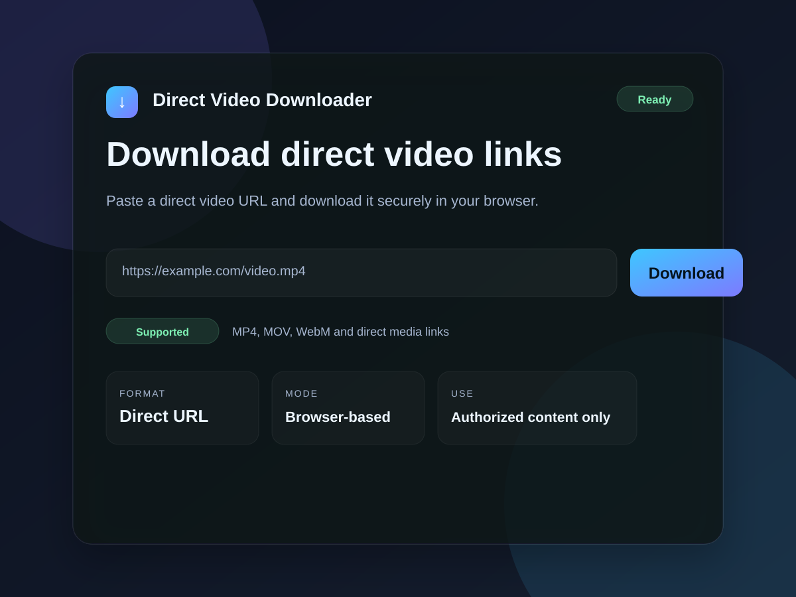

# direct-video-downloader

A simple browser-based downloader for direct video file URLs.

Created by: Showab Ahammad

## Preview

## Features
- Paste a direct video URL
- Download via browser
- Clean modern UI
- Works with direct media files such as MP4 and WebM

## Run locally
Open `index.html` in a browser.

## Files
- `index.html`
- `styles.css`
- `script.js`
